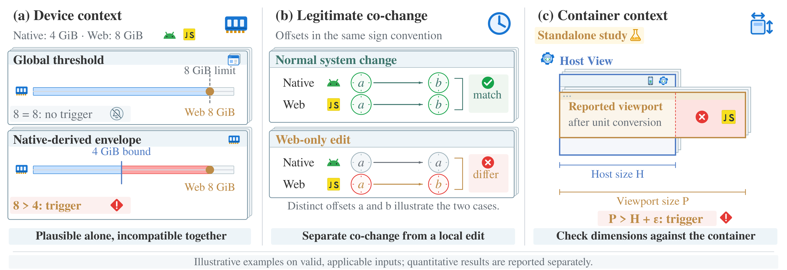

# Figure 3 — Contextual integrity mechanisms

## Current style revision: v3 (2026-10-23)

[Editable SVG](HybridGuard_Fig3_mechanisms_v3.svg) · [PNG preview](HybridGuard_Fig3_mechanisms_v3.png) · [Source package](HybridGuard_Fig3_mechanisms_v3_source.zip) · [Python builder](source/build_fig3_v3.py) · [Preservation checks](STYLE_V3_CHECK.json) · [Asset credits](style_v3_assets/ATTRIBUTION.md)



This revision applies the visual language of the current [Figure 1 v4](../overview/style_preserving_v4_20261023/HybridGuard_Fig1_surfaces_v4.svg) and [Figure 2](../system_design/semantic_vector_v1_20261023/HybridGuard_Fig2_semantic_v1.svg): subdued blue-grey stacked frames and saturated semantic icons. Android and vector JS identifiers distinguish Native and Web; blue memory/clock/dimension pictograms identify the three mechanisms. Green/red marks reinforce match/mismatch, and a neutral silent-bell symbol accompanies the global comparator's no-trigger outcome.

The **180 × 62 mm canvas, three-column arrangement, all 41 original text nodes and their full presentation attributes, and all 24 original scientific shapes are unchanged**. Original markers, arrows, brackets, dimensions and shared Host/viewport left edges retain their coordinates. The original footnote, standalone-study scope and bilingual caption remain applicable. Backgrounds, icons, and the exceeded-bound shading are additional vector geometry; there is no raster image embedded in the SVG and no external artwork dependency. Text remains editable.

Rebuild v3 from this directory:

```bash
python3 source/build_fig3_v3.py --export
```

Python 3 rebuilds the SVG and preservation-check JSON using the original v2 SVG and the included assets. `--export` also requires Inkscape and produces a 3600 × 1240 PNG. Nimbus Roman matches the original typography. A PDF can be exported from the SVG in Inkscape when needed.

The source ZIP includes v3 SVG, the baseline v2 SVG, the v3 builder, selected vector assets, asset notices/manifests, captions, and preservation checks. The original v2 artwork, builder and archive below remain the original source snapshot.

## Original review-v2 source archive

This directory preserves Figure 3 from `HybridGuard_three_figures_v2.zip` (2026-10-22). This schematic is **not** the earlier experimental `F03a` figure.

## Contents

- [HybridGuard_Fig3_mechanisms_v2.svg](HybridGuard_Fig3_mechanisms_v2.svg): original editable SVG, 180 × 62 mm
- [HybridGuard_Fig3_mechanisms_v2_source.zip](HybridGuard_Fig3_mechanisms_v2_source.zip): ready-to-use source package (SVG, Python builder, captions, manifests)
- [source/build_fig3.py](source/build_fig3.py): original Python vector builder
- [CAPTIONS.md](CAPTIONS.md): English and Chinese figure captions
- [SOURCE_MANIFEST.json](SOURCE_MANIFEST.json): original SHA-256 checksums for the SVG, PNG, PDF and builder

The panels show: (a) device context and a Native-derived memory envelope; (b) legitimate Native/Web timezone co-change versus a Web-only edit; (c) Host/container geometry. Examples are illustrative and add no measured records. The Host geometry study is standalone, not integrated with the main App detector.

## Rebuild and export

From this folder, with Python 3, Inkscape and Poppler:

```bash
python3 source/build_fig3.py --output HybridGuard_Fig3_mechanisms_v2.svg
inkscape HybridGuard_Fig3_mechanisms_v2.svg --export-type=pdf --export-filename=HybridGuard_Fig3_mechanisms_v2.pdf
pdftoppm -png -singlefile -scale-to-x 3600 -scale-to-y -1 HybridGuard_Fig3_mechanisms_v2.pdf HybridGuard_Fig3_mechanisms_v2
```

For the original Nimbus Roman typography, install the font locally (font files are not redistributed here). The ZIP also contains legacy review-v2 versions of Fig1 and Fig2, which are deliberately not duplicated: their newer variants are already archived in sibling directories `../overview/` and `../system_design/`.

**Original-v2 archival scope:** The editable v2 SVG and its code/metadata are committed here. Original v2 PDF and PNG exports are not part of this directory; use the export commands to regenerate them. The v3 SVG and preview are the current visual revision linked above.
