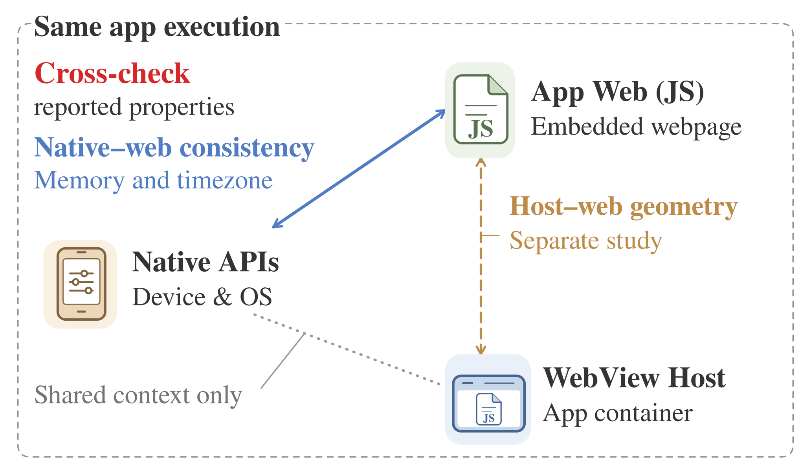

# HybridGuard overview — frozen v1

**2026-10-21：按作者确认保存的三角 overview。** 保留原版图标、衬线字体、配色与留白；最终按要求将底部灰色点线左端抬高 3 mm，并对齐注释引线。图尺寸为 86 × 50 mm，PNG 为 2064 × 1200 px。



## 材料

| 文件 | 用途 |
|---|---|
| [SVG](HybridGuard_overview_layout.svg) | 可编辑矢量源图，文字仍可编辑 |
| [PDF](HybridGuard_overview_layout.pdf) | 论文排版用矢量图，字体已嵌入 |
| [PNG](HybridGuard_overview_layout.png) | 审阅预览 |
| [CAPTIONS.md](CAPTIONS.md) | 中英文图注及使用说明 |
| [DESIGN_NOTES.txt](DESIGN_NOTES.txt) | 设计决策、语义边界和 WWW 文献参考 |
| [build_figure.py](build_figure.py) | 含源图的便携生成脚本 |
| [TABLER_LICENSE.txt](TABLER_LICENSE.txt) | 图标的 MIT 许可 |
| [FROZEN.json](FROZEN.json) | 来源、尺寸、最终改动和文件校验值 |
| [完整材料包](HybridGuard_overview_materials.zip) | 上述材料及本说明的下载包 |

## 图的职责与语义

三角图介绍同一次 App 执行中的 Native APIs、App Web (JS) 和 WebView Host 三个观测面及其关系。[已冻结的 system design](../../system_design/frozen_v1/README.md) 解释观测关联、完整性检查与结果汇总。

- 蓝色实线：当前检测器使用的 Native–App Web 内存和时区一致性关系。
- 赭色虚线：已实现并独立评估的 Host–web 几何关系，未纳入当前 Full App 检测器及其候选池。
- 灰色点线：共享上下文，不表示独立检测规则。
- 开放式箭头表示比较关系，不表示通信方向或相互认证。任何观测面都不是可信真值；同次执行不意味着原子同步采样。
- 内存检查采用容许上界，不是原始数值相等检查。单视图检查与可选的关联 Browser 在 system design 中解释。

正文核对基线：[03_method.tex](https://github.com/Xavi-L/RBA-Cross-Device-Fingerprint/blob/6c7440ad88bfde9d4efd3ae4562492b0db14b31c/output/pdf/hybridguard_www_draft_20261017/sections/03_method.tex)。本次提交保存新版图及其配套材料；论文中的 figure 引用由正文编排阶段接入。

## 复现与排版

SVG 生成仅需 Python 3 标准库；导出 PDF / PNG 另需 Inkscape 和 Nimbus Roman 字体。本版本使用 Inkscape 1.2.2 导出。

```bash
python3 paper/figures/overview/frozen_v1/build_figure.py --svg-only
python3 paper/figures/overview/frozen_v1/build_figure.py
```

默认输出至脚本旁的独立 `build/` 目录，可用 `--output-dir` 指定输出目录。脚本拒绝直接覆盖冻结目录。SVG 可逐字节复现；PDF 元数据和渲染可能随导出环境变化，排版使用保存的 PDF 即可。

在仓库根目录编译时，单栏示例：

```latex
\includegraphics[width=\columnwidth]{paper/figures/overview/frozen_v1/HybridGuard_overview_layout.pdf}
```

使用 [CAPTIONS.md](CAPTIONS.md) 中的图注并添加 system design 的交叉引用。保持图的长宽比。

## 检查与版本管理

最终 SVG 与获批版相比，仅两条路径的几何坐标改变：灰色点线左端与相应注释引线落点。全部文字、图标、颜色、线型及其他节点位置保持一致。导出 PDF 已视觉检查，无文字重叠或裁切；字体已嵌入，图形为矢量。便携脚本已验证能重建完全相同的 SVG。

后续修改请新增版本目录并注明变更，不静默覆盖本目录。文献只保留引用链接，不附带第三方论文或图稿。
