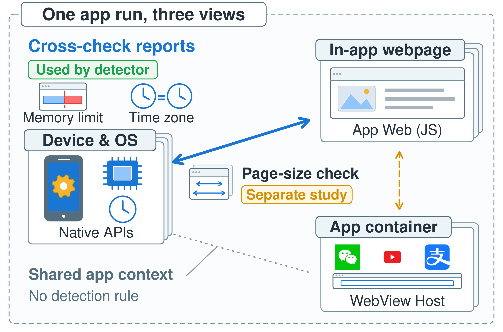

# HybridGuard Figure 1 - icon overview v2

**2026-10-23: redrawn using Figure 2's visual style.** This revision preserves the Native / App Web / WebView Host triangle and adopts the saturated semantic palette, Nimbus Sans typography, compact layered frames, and recognizable icons used by the current [Figure 2](../../system_design/semantic_vector_v1_20261023/README.md).

This is a new redraw for author review. The [previous frozen overview](../frozen_v1/README.md) remains available, and manuscript references are not changed by this addition.



## Files

| File | Purpose |
| --- | --- |
| [HybridGuard_Fig1_overview_v2.svg](HybridGuard_Fig1_overview_v2.svg) | Self-contained editable vector artwork, live text, named groups, and Inkscape layers. |
| [HybridGuard_Fig1_overview_v2.pdf](HybridGuard_Fig1_overview_v2.pdf) | Vector figure for manuscript placement, with embedded fonts. |
| [HybridGuard_Fig1_overview_v2.png](HybridGuard_Fig1_overview_v2.png) | 3000 x 1980 review preview. |
| [build_figure.py](build_figure.py) | Portable generator using Python's standard library; Inkscape exports PNG/PDF. |
| [CAPTIONS.md](CAPTIONS.md) | English/Chinese captions and alternative text. |
| [SOURCE_MAP.json](SOURCE_MAP.json) | Source baseline, visual-style source, palette, and asset hashes. |
| [QUALITY_CHECK.json](QUALITY_CHECK.json) | SVG and export inspection records. |
| [VISUAL_REVIEW.md](VISUAL_REVIEW.md) | Visual and semantic review notes. |
| [assets/](assets/) | Three original brand SVGs, provenance, and retained notices. |
| [source_materials.zip](source_materials.zip) | Generator, SVG, assets, and documentation for reproduction. |

## Design decisions

- Plain object names are prominent: Device & OS, In-app webpage, and App container. The smaller technical names retain the mapping to Native APIs, App Web (JS), and WebView Host.
- The three views occupy compact stacked frames. In-app webpages have no standalone-browser logo. WeChat, YouTube, and Alipay illustrate ordinary app categories within the container, rather than a tested-brand list.
- Saturated blue technical icons, blue/red memory-limit graphics, gold settings detail, and original logo colors echo Figure 2. Supporting borders and the execution boundary stay subdued.
- Thick solid blue open arrows mark the current comparison. Thinner dashed amber open arrows mark the separate geometry study. A gray dotted edge with no arrowhead marks context only.
- The two upper check-family icons explain the main relationship; a page-size pictogram uses the triangle's interior. The left endpoint of the lower contextual edge remains higher than its right endpoint, preserving the triangle silhouette.
- No per-view acceptance tick or rejection cross is added: this overview describes relationship scope rather than a particular evaluation result.

## Relationship scope

| Figure relationship | Meaning |
| --- | --- |
| Cross-check reports / Used by detector | Native-Web memory upper-bound and effective-timezone consistency checks used by the current detector. |
| Page-size check / Separate study | Host-Web geometry that is implemented and separately evaluated, outside the current Full App detector and its candidate pool. |
| Shared app context / No detection rule | Shared execution context, not an independent detection rule. |

The triangle is not a voting loop, a communication diagram, or a guarantee that one view is trusted ground truth. The memory icon depicts an upper bound, not direct equality. The clocks are symbolic effective-timezone agreement. Figure 2 contains single-view checks, optional linked Browser input, and full decision processing. See the captions for the complete qualification.

The semantic baseline is [the prior overview caption](../frozen_v1/CAPTIONS.md) and [the method section](../../../../output/pdf/hybridguard_www_draft_20261017/sections/03_method.tex) at repository commit `b49c53ffcb2eaacf1cf9fbaff43b99d18fc469a1`.

## Reproduction and placement

The canvas is **1000 x 660 viewBox units**, with a physical size of **86 x 56.76 mm** for a single column. Text uses Nimbus Sans, with Arial and Liberation Sans fallbacks; use Nimbus Sans for the reviewed text metrics. The SVG contains **16 editable text elements**, no bitmap image elements, and no external image links.

```bash
python3 paper/figures/overview/icon_vector_v2_20261023/build_figure.py
# SVG only, without requiring Inkscape:
python3 paper/figures/overview/icon_vector_v2_20261023/build_figure.py --svg-only
```

The script writes beside itself and regenerates the SVG, exports, source mapping, and structural report. A rebuild does not claim a new visual review. The source ZIP excludes PNG/PDF exports, which are available alongside it. Geometry and labels are created as native SVG, and logos are inlined from their original SVG sources.

```latex
\includegraphics[width=\columnwidth]{paper/figures/overview/icon_vector_v2_20261023/HybridGuard_Fig1_overview_v2.pdf}
```

Maintain the aspect ratio. Use the PDF for fixed-layout manuscript placement and the SVG for editing.
