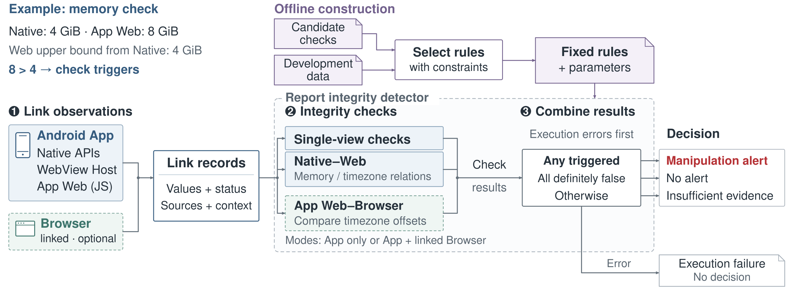

# HybridGuard system design — frozen v1

**2026-10-21：按作者确认冻结的 system design 图。** 本目录保存获批图稿的原始 SVG、PDF、PNG 字节，并提供图注、语义说明和可复现脚本。冻结图为 180 × 66 mm；PNG 为 2700 × 990 px。



## 材料

| 文件 | 用途 |
|---|---|
| [SVG](HybridGuard_system_design_layout.svg) | 可编辑矢量源图，文字仍为文字 |
| [PDF](HybridGuard_system_design_layout.pdf) | 论文排版用矢量图，字体已嵌入 |
| [PNG](HybridGuard_system_design_layout.png) | 审阅预览 |
| [CAPTIONS.md](CAPTIONS.md) | 英文图注与中文译文 |
| [DESIGN_NOTES.txt](DESIGN_NOTES.txt) | 批准版本的原始设计说明、具体语义、文献参考及审阅范围 |
| [build_figure.py](build_figure.py) | 便携生成脚本；默认写入独立的 `build/` 目录 |
| [FROZEN.json](FROZEN.json) | 冻结状态、来源、尺寸及 SHA-256 / Git blob 校验值 |

`DESIGN_NOTES.txt` 保留了制图完成时的原始记录；末尾“尚未修改 GitHub”的陈述指当时的制作阶段。本目录所在提交是随后获得授权的冻结入库。

## 本图的职责与语义

这张图解释观测关联、完整性检查、结果汇总与离线规则选择。三角 overview 负责介绍观测面及关系范围，独立于本次冻结。

- 图中的 App only 对应 Full App；App + linked Browser 对应 Full App + C1，是两种配置。
- C1 使用有效关联的 App Web / Browser 时区偏移。Host–Web 几何仍属于单独研究，不是当前 Full App 选中检查。
- 选中依赖的执行或关联失败优先于报警；未报警不代表真实性或安全。缺失、不可用和不适用不能自动等同于正常。
- 内存 4 GiB / 8 GiB 为合成示例；展示有效输入上的上界检查，不是原始数值相等检查，也不把 Native 当作可信真值。
- 固定规则和参数用于检查及汇总；离线构建与当前执行分开。图中模块表示逻辑职责，不代表独立部署服务。

正文核对基线：[03_method.tex](https://github.com/Xavi-L/RBA-Cross-Device-Fingerprint/blob/6c7440ad88bfde9d4efd3ae4562492b0db14b31c/output/pdf/hybridguard_www_draft_20261017/sections/03_method.tex)。本次入库不修改正文的 figure 引用，也不替换原 combined overview 的历史材料。

## 复现

SVG 生成只需 Python 3 标准库。导出 PDF / PNG 另需 Inkscape 和 Nimbus Sans 字体；冻结 PDF 已嵌入所用字体。批准版本使用 Inkscape 1.2.2 导出。

```bash
python3 paper/figures/system_design/frozen_v1/build_figure.py --svg-only
python3 paper/figures/system_design/frozen_v1/build_figure.py
```

默认输出在本目录下的 `build/`；也可用 `--output-dir /path/to/output` 指定独立目录。脚本拒绝覆盖本目录中的冻结原件。SVG 已验证可以逐字节复现；PDF / PNG 的元数据和字体渲染可能因导出环境而不同，论文使用冻结 PDF 即可。

在仓库根目录编译论文时，可使用：

```latex
\includegraphics[width=\textwidth]{paper/figures/system_design/frozen_v1/HybridGuard_system_design_layout.pdf}
```

建议以双栏通栏宽度使用，保持长宽比。若从其他目录编译，请相应调整相对路径，并在 figure 环境中采用 [CAPTIONS.md](CAPTIONS.md) 的图注。

## 冻结检查

三种图稿均直接复制批准版本，SHA-256 完全一致；便携脚本重建的 SVG 与冻结 SVG 完全一致。PDF 为单页矢量图，无嵌入位图，字体已嵌入。发布时使用 `FROZEN.json` 中的摘要确认文件身份。第三方论文只以文献链接引用，未复制其 PDF 或图形。

后续修改应建立新版本目录并注明变更，不静默覆盖本目录。
